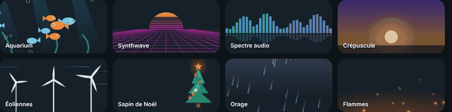
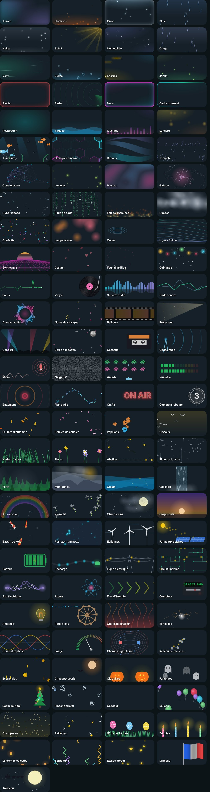

# ✨ HOLM FX

[🇫🇷 Français](README.md) · 🇬🇧 English

[](https://hacs.xyz/)


**113 animated ambiences around any Home Assistant card: flames when the heating is on, rain when it rains, an equaliser when music is playing.**

HOLM FX wraps an existing card (tile, Mushroom, Bubble, a HOLM card…) and animates its background. The ambience can switch on from an entity: heating running, player playing, solar production above a threshold… It can also be used as a plain animated background.

> ✨ **Full visual editor**: pick the ambience, the card to wrap and the trigger, with a live preview.



### At a glance

- 🎬 **113 ambiences in 10 families**: Ambience, Heating & cooling, Weather, Water, Energy, Nature, Security, Media, Tech, Celebrations.
- 🧩 **Any card** inside, or a plain animated background of the height you want.
- 🔌 **Entity trigger**: state, attribute, threshold (above / below); for a thermostat, the current action (heating, cooling) is read automatically.
- 😴 **When inactive**: soft glow and slowed animation, frozen animation, hidden ambience, or another ambience.
- 🎨 **Adjustable**: colours (or the theme's), intensity, speed, density, size, opacity, veil, blur, background (theme, glass, transparent, night), glowing edge, and settings specific to some ambiences.
- 🌍 **8 languages**: French, English, German, Spanish, Italian, Dutch, Portuguese and Polish. The editor, the families, the 113 ambiences and their settings follow your profile language, or the one chosen in the **Language** option.
- 🪶 **Light on resources**: animations pause off-screen or in a hidden tab, frames per second are capped, they can stop after a delay, and the device's "reduce motion" setting is respected.

---

## Installation

### With HACS (recommended)

1. HACS → ⋮ menu → **Custom repositories**.
2. Add `https://github.com/kaaribou/holm-fx-card`, category **Dashboard** (*Plugin*).
3. Search for **HOLM FX** → **Download**.
4. Reload the page (Ctrl + F5).

### Manually

1. Copy `dist/holm-fx-card.js` to `config/www/community/holm-fx-card/`.
2. **Settings → Dashboards → ⋮ → Resources → Add**: `/local/community/holm-fx-card/holm-fx-card.js`, type **JavaScript module**.
3. Reload the page.

> **Were you using HOLM FX with HOLM Theme Editor 1.0?** Install HOLM FX as above; your cards do not change. HOLM Theme Editor 1.1 no longer ships the card.

---

## Usage

Flames around a thermostat, only while it is heating:

```yaml
type: custom:holm-fx-card
ambiance: flammes
entity: climate.living_room
card:
  type: tile
  entity: climate.living_room
```

An equaliser while music plays, a starry night otherwise:

```yaml
type: custom:holm-fx-card
ambiance: spectre
entity: media_player.living_room
state: playing
inactive_ambiance: nuit
card:
  type: media-control
  entity: media_player.living_room
```

A plain animated background, with no card:

```yaml
type: custom:holm-fx-card
ambiance: aurore
height: 120
```

> Ambience identifiers (`flammes`, `spectre`, `aurore`…) stay in French whatever the language, so your YAML keeps working when the language changes.

## The visual editor

| Element | What it is for |
|---|---|
| **Language** | Editor language. "Automatic (profile)" follows your Home Assistant profile language |
| **Ambience** | List of the 113 ambiences, grouped by family ("Weather · Rain") |
| **Trigger** | Entity, attribute, active states, "active above" / "active below" thresholds, behaviour when the entity is inactive and replacement ambience |
| **Appearance** | Colours, intensity, speed, density, size, opacity, dark veil, blur, card background and glowing edge |
| **"…" settings** | Settings specific to the chosen ambience (number of fish, tempo, fixed level…), shown only when it has some |
| **Performance** | Maximum frames per second and delay before freezing the animation |
| **Wrapped card** | Editor of the card placed inside. **YAML code** / **Visual editor** switches between both modes, **Change card** opens the card picker |

## Options

| Option | Description | Default |
|---|---|---|
| `language` | Editor language: `fr`, `en`, `de`, `es`, `it`, `nl`, `pt`, `pl` (empty = profile language) | profile |
| `ambiance` | Ambience identifier (see the gallery, or the list in the editor) | `aurore` |
| `card` | Card to wrap | — |
| `height` | Height of a plain animated background, with no card (`120` or `8rem`) | — |
| `entity` | Entity that switches the ambience on (with no entity, the ambience is always active) | — |
| `attribute` | Attribute to read instead of the state | — |
| `state` | Active states (one or more) | anything but `off`, `idle`, `unavailable`… |
| `above` / `below` | Active above / below a value | — |
| `inactive` | When inactive: `calme` (soft glow), `pause` (frozen), `masque` (hidden) | `calme` |
| `inactive_ambiance` | Another ambience when inactive | — |
| `color` / `color2` | Colours (`#ff7a2a`, `255, 122, 42` or `theme`) | the ambience's |
| `intensity` · `speed` · `density` · `scale` | Intensity, speed, density, size | `1` |
| `opacity` · `overlay` · `blur` | Ambience opacity, dark veil, blur | `1` · `0` · `0` |
| `background` | Background: theme, `verre` (glass), `transparent`, `sombre` (night) | theme |
| `frame` | Glowing edge | depends on the ambience |
| `params` | Settings specific to the ambience (shown in the editor) | — |
| `max_fps` | Maximum frames per second | `30` |
| `static_after` | Freezes the animation after this many seconds | — |

## Gallery

The 113 ambiences, in editor order:



| Family | Ambiences |
|---|---|
| Ambience | Aurora, Neon, Spinning frame, Breathing, Light, Ribbons, Plasma, Galaxy, Lava lamp, Flowing lines |
| Heating & cooling | Flames, Frost, Wind, Fireplace |
| Weather | Rain, Snow, Sun, Starry night, Thunderstorm, Storm, Clouds |
| Water | Bubbles, Waves, Aquarium, Ripples |
| Energy | Energy, Wind turbines, Solar panels, Battery, Charging, Power line, Circuit board, Electric arc, Atom, Energy flow, Meter, Light bulb, Water wheel, Heat haze, Sparks, Three-phase current, Gauge, Magnetic field, House grid, Savings |
| Nature | Garden, Fireflies, Autumn leaves, Cherry blossoms, Butterflies, Birds, Tall grass, Flowers, Bees, Rain on the window, Forest, Mountains, Ocean, Waterfall, Rainbow, Dandelion, Moonlight, Dusk, Koi pond, Glowing plankton |
| Security | Alert, Radar |
| Media | Music, Vinyl, Audio spectrum, Sound wave, Audio ring, Music notes, Film strip, Projector, Concert, Disco ball, Cassette, Radio waves, Microphone, TV static, Arcade, VU meter, Beat, Audio stream, On Air, Countdown |
| Tech | Neon hexagons, Constellation, Hyperspace, Code rain, Synthwave, Pulse |
| Celebrations | Confetti, Hearts, Fireworks, String lights, Bats, Pumpkins, Ghosts, Christmas tree, Crystal snowflakes, Presents, Balloons, Champagne, Glitter, Easter eggs, Candles, Sky lanterns, Streamers, Golden stars, Flag, Sleigh |

## FAQ / troubleshooting

| Problem | Solution |
|---|---|
| The ambience never switches on | Check the entity state; set `state:` (e.g. `playing`, `heating`) or an `above:` threshold. |
| Animations do not move | The device's "reduce motion" setting is on, or `static_after` is set. |
| A phone gets warm | Lower `max_fps` (15), `density`, or use `static_after`. |
| The new version does not show | Clear the cache (Ctrl + F5). |
| The editor is not in my language | Pick it in the **Language** option, or check your profile language. |

---

## A small thank-you?

Like the card? You can buy me a beer 🍺

[](https://paypal.me/kaaribou)

---

## License

Code: **MIT** license — © kaaribou. See the [CHANGELOG](CHANGELOG.md).

Part of **HOLM — Home Orchestration & Living Management**: smart management and orchestration of the home.

Other projects: [Volets HOLM](https://github.com/kaaribou/volets-holm) · [Climat HOLM](https://github.com/kaaribou/climat-holm) · [Carburant HOLM](https://github.com/kaaribou/carburant-holm) · [Commandes à la maison HOLM](https://github.com/kaaribou/commandes-holm) · [HOLM LaMetric](https://github.com/kaaribou/lametric-holm) · [HOLM My Menu](https://github.com/kaaribou/holm-mymenu) · [HOLM Lektrico](https://github.com/kaaribou/lektrico-holm) · [HOLM GitHub](https://github.com/kaaribou/github-holm) · [HOLM Cars](https://github.com/kaaribou/holm-cars) · [HOLM HP/HC](https://github.com/kaaribou/holm-tarif) · [HOLM Navbar Card](https://github.com/kaaribou/holm-navbar-card) · [HOLM Climate Card](https://github.com/kaaribou/climate-card-holm) · [HOLM Music Card](https://github.com/kaaribou/holm-music-card) · [HOLM Sentinel Card](https://github.com/kaaribou/holm-sentinel-card) · [HOLM Security Card](https://github.com/kaaribou/holm-security-card) · [HOLM Recordings Card](https://github.com/kaaribou/holm-recordings-card) · [HOLM Covers Card](https://github.com/kaaribou/holm-covers-card) · [HOLM Runtime Card](https://github.com/kaaribou/holm-runtime-card) · [HOLM Power Flow Card](https://github.com/kaaribou/holm-power-flow-card) · [HOLM Energy Cards](https://github.com/kaaribou/holm-energy-cards) · [HOLM Radiator Card](https://github.com/kaaribou/holm-radiator-card) · [HOLM Floor Card](https://github.com/kaaribou/holm-floor-card) · [HOLM Ecojoko Card](https://github.com/kaaribou/holm-ecojoko-card) · [HOLM Smoke Card](https://github.com/kaaribou/holm-smoke-card) · [HOLM Family Card](https://github.com/kaaribou/holm-family-card) · [HOLM Live Power Card](https://github.com/kaaribou/holm-live-power-card) · [HOLM Solar Optimizer Card](https://github.com/kaaribou/holm-solar-optimizer-card) · [HOLM Govee Light Card](https://github.com/kaaribou/holm-govee-light-card) · [HOLM Leapmotor Card](https://github.com/kaaribou/holm-leapmotor-card). · [HOLM Bins](https://github.com/kaaribou/holm-bins) · [HOLM Theme Editor](https://github.com/kaaribou/holm-theme)
