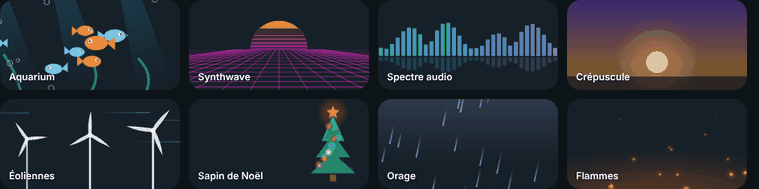
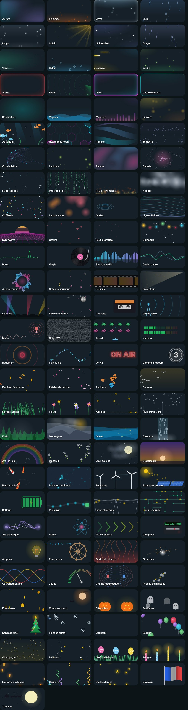

# ✨ HOLM FX

[](https://hacs.xyz/)


**113 ambiances animées autour de n'importe quelle carte Home Assistant : des flammes quand ça chauffe, la pluie quand il pleut, un égaliseur quand la musique joue.**

HOLM FX enveloppe une carte existante (tuile, Mushroom, Bubble, une carte HOLM…) et anime son fond. L'ambiance peut s'allumer selon une entité : le chauffage qui chauffe, le lecteur en lecture, la production solaire au-dessus d'un seuil… Elle peut aussi servir de simple fond animé.

> ✨ **Éditeur visuel complet** : on choisit l'ambiance, la carte à envelopper et le déclenchement, avec l'aperçu en direct.



### En bref

- 🎬 **113 ambiances en 10 familles** : Ambiance, Chauffage et clim, Météo, Eau, Énergie, Nature, Sécurité, Médias, Tech, Fêtes.
- 🧩 **N'importe quelle carte** à l'intérieur, ou un simple fond animé de la hauteur voulue.
- 🔌 **Déclenchement par entité** : état, attribut, seuil (au-dessus / en dessous) ; pour un thermostat, l'action en cours (chauffe, refroidit) est lue automatiquement.
- 😴 **Quand c'est inactif** : halo discret et animation ralentie, animation figée, ambiance masquée, ou une autre ambiance.
- 🎨 **Réglable** : couleurs (ou celles du thème), intensité, vitesse, densité, taille, opacité, voile, flou, fond (thème, verre, transparent, nuit), cadre lumineux, et des réglages propres à certaines ambiances.
- 🪶 **Économe** : animations en pause hors de l'écran ou dans un onglet caché, images par seconde limitées, arrêt possible après un délai, et respect du réglage « animations réduites » de l'appareil.

---

## Installation

### Avec HACS (recommandé)

1. HACS → menu ⋮ → **Dépôts personnalisés**.
2. Ajoutez `https://github.com/kaaribou/holm-fx-card`, catégorie **Tableau de bord** (*Dashboard / Plugin*).
3. Recherchez **HOLM FX** → **Télécharger**.
4. Rechargez la page (Ctrl + F5).

### Manuellement

1. Copiez `dist/holm-fx-card.js` dans `config/www/community/holm-fx-card/`.
2. **Paramètres → Tableaux de bord → ⋮ → Ressources → Ajouter** : `/local/community/holm-fx-card/holm-fx-card.js`, type **Module JavaScript**.
3. Rechargez la page.

> **Vous utilisiez HOLM FX avec HOLM Theme Editor 1.0 ?** Installez HOLM FX comme ci-dessus ; vos cartes ne changent pas. HOLM Theme Editor 1.1 ne fournit plus la carte.

---

## Utilisation

Des flammes autour d'un thermostat, seulement quand il chauffe :

```yaml
type: custom:holm-fx-card
ambiance: flammes
entity: climate.salon
card:
  type: tile
  entity: climate.salon
```

Un égaliseur quand la musique joue, une nuit étoilée sinon :

```yaml
type: custom:holm-fx-card
ambiance: spectre
entity: media_player.salon
state: playing
inactive_ambiance: nuit
card:
  type: media-control
  entity: media_player.salon
```

Un simple fond animé, sans carte :

```yaml
type: custom:holm-fx-card
ambiance: aurore
height: 120
```

## Options

| Option | Description | Par défaut |
|---|---|---|
| `ambiance` | Identifiant de l'ambiance (voir la galerie, ou la liste dans l'éditeur) | `aurore` |
| `card` | Carte à envelopper | — |
| `height` | Hauteur d'un simple fond animé, sans carte (`120` ou `8rem`) | — |
| `entity` | Entité qui allume l'ambiance (sans entité, l'ambiance est toujours active) | — |
| `attribute` | Attribut à lire au lieu de l'état | — |
| `state` | États actifs (un ou plusieurs) | tout sauf `off`, `idle`, `unavailable`… |
| `above` / `below` | Active au-dessus / en dessous d'une valeur | — |
| `inactive` | Quand c'est inactif : `calme` (halo discret), `pause` (figée), `masque` (masquée) | `calme` |
| `inactive_ambiance` | Une autre ambiance quand c'est inactif | — |
| `color` / `color2` | Couleurs (`#ff7a2a`, `255, 122, 42` ou `theme`) | celles de l'ambiance |
| `intensity` · `speed` · `density` · `scale` | Intensité, vitesse, densité, taille | `1` |
| `opacity` · `overlay` · `blur` | Opacité de l'ambiance, voile sombre, flou | `1` · `0` · `0` |
| `background` | Fond : thème, `verre`, `transparent`, `sombre` | thème |
| `frame` | Cadre lumineux | selon l'ambiance |
| `params` | Réglages propres à l'ambiance (affichés dans l'éditeur) | — |
| `max_fps` | Images par seconde maximum | `30` |
| `static_after` | Fige l'animation après ce nombre de secondes | — |

## Galerie

Les 113 ambiances, dans l'ordre de l'éditeur :



| Famille | Ambiances |
|---|---|
| Ambiance | Aurore, Néon, Cadre tournant, Respiration, Lumière, Rubans, Plasma, Galaxie, Lampe à lave, Lignes fluides |
| Chauffage et clim | Flammes, Givre, Vent, Feu de cheminée |
| Météo | Pluie, Neige, Soleil, Nuit étoilée, Orage, Tempête, Nuages |
| Eau | Bulles, Vagues, Aquarium, Ondes |
| Énergie | Énergie, Éoliennes, Panneaux solaires, Batterie, Recharge, Ligne électrique, Circuit imprimé, Arc électrique, Atome, Flux d'énergie, Compteur, Ampoule, Roue à eau, Ondes de chaleur, Étincelles, Courant triphasé, Jauge, Champ magnétique, Réseau de maisons, Économies |
| Nature | Jardin, Lucioles, Feuilles d'automne, Pétales de cerisier, Papillons, Oiseaux, Herbes hautes, Fleurs, Abeilles, Pluie sur la vitre, Forêt, Montagnes, Océan, Cascade, Arc-en-ciel, Pissenlit, Clair de lune, Crépuscule, Bassin de koïs, Plancton lumineux |
| Sécurité | Alerte, Radar |
| Médias | Musique, Vinyle, Spectre audio, Onde sonore, Anneau audio, Notes de musique, Pellicule, Projecteur, Concert, Boule à facettes, Cassette, Ondes radio, Micro, Neige TV, Arcade, Vumètre, Battement, Flux audio, On Air, Compte à rebours |
| Tech | Hexagones néon, Constellation, Hyperespace, Pluie de code, Synthwave, Pouls |
| Fêtes | Confettis, Cœurs, Feux d'artifice, Guirlande, Chauves-souris, Citrouilles, Fantômes, Sapin de Noël, Flocons cristal, Cadeaux, Ballons, Champagne, Paillettes, Œufs de Pâques, Bougies, Lanternes célestes, Serpentins, Étoiles dorées, Drapeau, Traîneau |

## FAQ / dépannage

| Problème | Solution |
|---|---|
| L'ambiance ne s'allume jamais | Vérifiez l'état de l'entité ; précisez `state:` (ex. `playing`, `heating`) ou un seuil `above:`. |
| Les animations ne bougent pas | Le réglage « animations réduites » de l'appareil est activé, ou `static_after` est réglé. |
| Un téléphone chauffe | Baissez `max_fps` (15), `density`, ou utilisez `static_after`. |
| La nouvelle version ne s'affiche pas | Videz le cache (Ctrl + F5). |

---

## Un petit merci ?

La carte vous plaît ? Vous pouvez m'offrir une bière 🍺

[](https://paypal.me/kaaribou)

---

## Licence

Code : licence **MIT** — © kaaribou. Voir le [CHANGELOG](CHANGELOG.md).

Fait partie de la collection **HOLM** — Home Orchestration & Living Management. Pour créer vos thèmes avec aperçu en direct : [HOLM Theme Editor](https://github.com/kaaribou/holm-theme).
